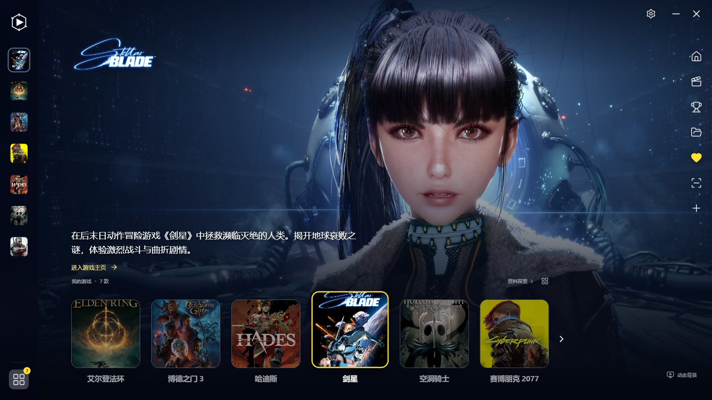
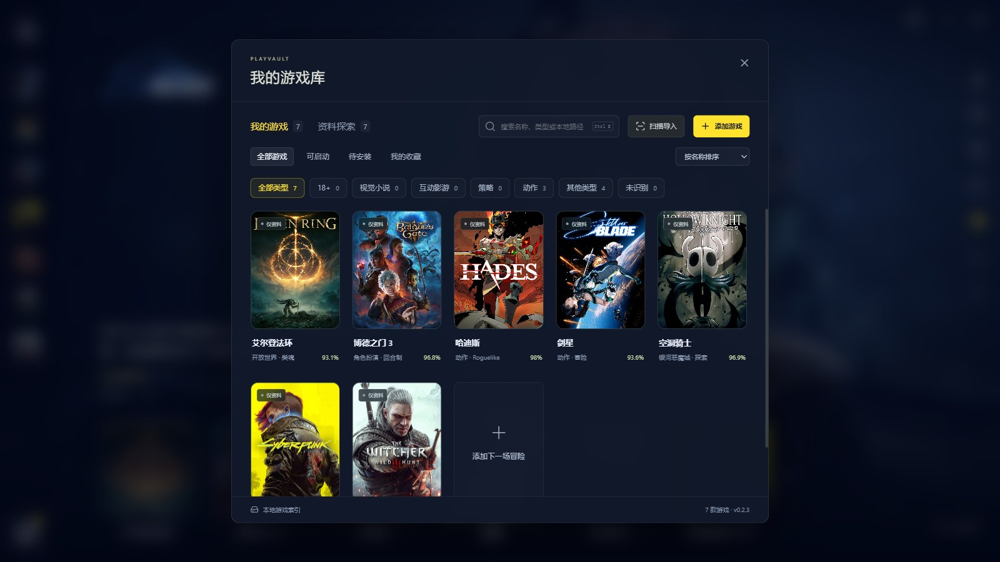
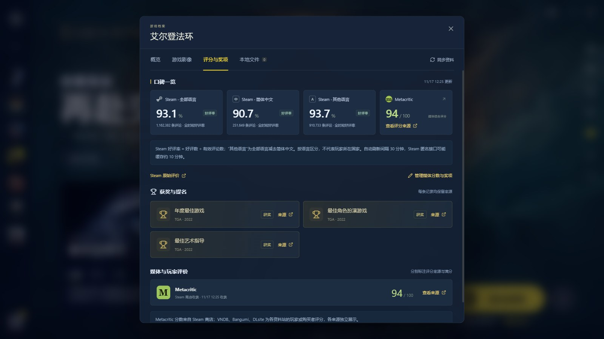

# 游迹 PlayVault

面向 Windows PC 玩家的本地游戏管理器。把散落在不同磁盘里的游戏程序、压缩包和安装镜像放进同一个游戏库，再为每场冒险配上宣传图、视频、评分和获奖记录。

参考 HoYoPlay 的沉浸式布局，以 Electron、React 和 TypeScript 实现。当前版本 **v0.2.3**。


## 界面截图

| 游戏总览 | 搜索与类型筛选 |
| --- | --- |
|  |  |



截图来自独立演示库，使用公开的游戏商店资料，不包含个人游戏目录或安装文件。示例游戏只用于展示界面。

## 功能

- **跨磁盘管理**：关联已安装游戏、EXE 安装程序、ZIP／7Z／RAR 压缩包及 ISO 镜像；同一游戏可保留多份副本。
- **只读扫描**：识别 Steam 清单、跳过系统目录和常见辅助程序；文件检测工具、安装程序、更新补丁不会作为游戏本体启动。
- **沉浸式主页**：宣传背景、游戏 Logo、截图、预告片、HLS 视频、本地 MP4／WebM／GIF，支持缓存后离线查看。
- **收藏与筛选**：可滚动的收藏栏；18+、视觉小说、互动影游、策略、动作及未识别筛选；可叠加安装状态、搜索和排序。
- **资料与评分**：Steam 宣传资料及评论统计，已关联的 VNDB、Bangumi、DLsite 条目同步，媒体评分和获奖／提名记录。
- **安装与启动**：选择游戏 EXE、按程序所在目录启动、记录进程运行时长；通过本机 7-Zip 解压安装包。
- **数据管理**：JSON 索引导出与合并导入；配置安装目录、7-Zip 和自动刷新；脚本、EXE、任务栏入口共用数据目录。

## 从源码运行

需要 Windows、Node.js 24 和 npm。

```powershell
git clone https://github.com/Kirrito-k423/PlayVault.git
cd PlayVault
npm ci
npm run demo:download
npm run dev
```

`demo:download` 从公开商店下载示例宣传素材并更新示例资料，需要联网。下载内容保存在 `resources/art/`，不纳入 Git。可以跳过这一步，直接添加自己的游戏并同步资料；未下载的示例封面会显示占位图。

```powershell
npm run build       # 类型检查和生产构建
npm start           # 运行构建后的桌面程序
npm run package     # 生成 Windows 文件夹版和单文件便携版
```

构建输出位于 `release/`。已打包时可双击 `启动游迹.cmd`，或直接运行 `release/win-unpacked/PlayVault.exe`，也可把 EXE 固定到任务栏。文件夹版需要保留完整的 `win-unpacked` 文件夹。

## 使用方法

1. 通过“扫描导入”添加游戏目录，检查候选结果后加入游戏库。
2. 在游戏的“本地文件”中选择启动 EXE、关联其他安装包，或合并重复记录。
3. 在“编辑／匹配游戏”中填写 Steam App ID 或商店链接，再同步宣传资料和评分。添加对话框也支持 Steam 搜索。
4. 已关联 VNDB、Bangumi、DLsite 条目的游戏可从档案中同步资料。在线搜索目前以 Steam 为主，尚无完整的多来源自动匹配界面。
5. 已安装游戏可以启动；压缩包可解压；EXE 安装包和 ISO 使用单独的“运行安装程序／打开镜像”操作。

扫描采用文件特征识别，仍需核对结果。默认最多遍历 60,000 项、9 层目录，达到上限会提示缩小范围。远程盘上的安装包需要先安装；可正常运行的远程游戏 EXE 仍可关联。

## 数据保存位置

在本项目目录中，启动脚本、`release/win-unpacked/PlayVault.exe` 和 `release/` 下的便携版统一使用项目根目录的 `data/`，不受快捷方式工作目录影响。

```text
data/
  library.json        游戏索引、收藏、启动项和设置
  catalog-cache.json  示例资料更新缓存
  media/              自定义媒体及缓存
  chromium/           桌面浏览器缓存
```

脱离本项目目录独立放置的便携版／文件夹版使用自身旁边的 `data/`。迁移完整游戏库时复制整个 `data/`；索引不包含游戏本体，换电脑后可能需要重新关联路径。

可显式设置 `PLAYVAULT_DATA_DIR` 指定目录。npm、开发和构建缓存默认放在项目的 `.cache/`，便于把整个项目放在空间充足的磁盘。

## 评分与素材来源

- Steam 展示全部语言、简体中文及其他语言的好评率，使用公开的 [GetAppReviews 接口](https://partner.steamgames.com/doc/webapi/IUserReviewsService)。其他语言计数由全部计数减去简体中文计数；**语言不等于玩家国籍**。
- VNDB 为玩家贝叶斯评分，Bangumi 为资料站玩家评分，DLsite 为购买者评价；各自保留原始来源、满分和时间，分别展示。
- Metacritic 分数来自 Steam 商店返回的数据。其他媒体分数可带来源手动录入；尚未接入 OpenCritic、IGN 等站点的自动评分 API。
- TGA 展示获奖与提名，不生成“TGA 分数”。示例奖项来源位于 [`resources/awards.json`](resources/awards.json)。
- 同步获取的是接口当前可用的数据，不保证逐秒实时。网络失败保留缓存；缺失数据留空。
- 示例游戏宣传图、Logo 和视频来自公开商店及发行商页面，来源记录见 [`resources/art-sources.json`](resources/art-sources.json)。完整宣传素材不随源码分发；可按需下载到本机。

## 安装包与文件处理

解压依赖本机安装的 **7-Zip**，可在设置中指定 `7z.exe`。处理前检查压缩包路径、链接、重复项、加密标记和大小；在独立目录解压，同名目录存在时拒绝覆盖。源安装包保持原样。

当前不支持加密压缩包、自动执行安装脚本或静默安装。移除记录、合并游戏和解除文件关联只修改索引。进程型启动器可能导致时长统计偏短，退出游迹后不继续跟踪。

## 开发与测试

```powershell
npm test                  # 文件识别、资料同步、持久化、路径和解压测试
npm run test:desktop      # 桌面交互与截图，需要先下载演示素材
npm run test:e2e          # 扫描、导入、测试 EXE、解压、重启、视频及在线评分
npm run screenshots       # 在独立演示库中生成 README 截图
node scripts/packaged-smoke.mjs  # 打包完整性与原生 IPC 检查
npm run test:persistence   # 打包 EXE：三次冷启动验证收藏、设置和资料
```

桌面检查需要先运行 `npm run build`；打包检查需要先运行 `npm run package`。测试使用 `.test-data/` 下的独立目录，E2E 只执行临时生成的测试程序。E2E 需要 Windows 的 .NET Framework C# 编译器与 7-Zip，可通过 `PLAYVAULT_7ZIP` 指定测试用的 `7z.exe`。

GitHub Actions 在 Windows 上执行单元测试与构建。主进程位于 `electron/`，界面位于 `src/`，共享模型与分类规则位于 `shared/`。

## 许可证

原创源码和应用图标使用 [MIT License](LICENSE)。第三方依赖的许可证见 [`resources/THIRD-PARTY-NOTICES.txt`](resources/THIRD-PARTY-NOTICES.txt)。游戏名称、商标、宣传素材及截图中的第三方内容归相应权利人所有，不属于本项目 MIT 授权范围。应用不提供商业游戏文件或游戏授权。
